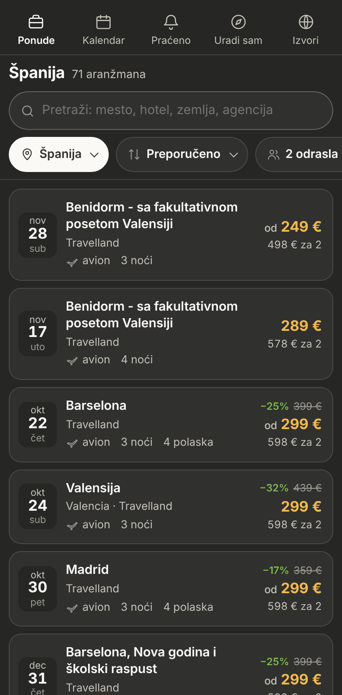
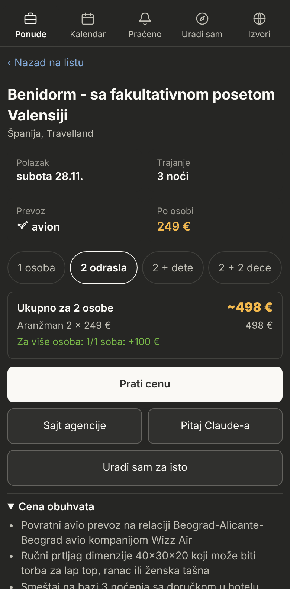
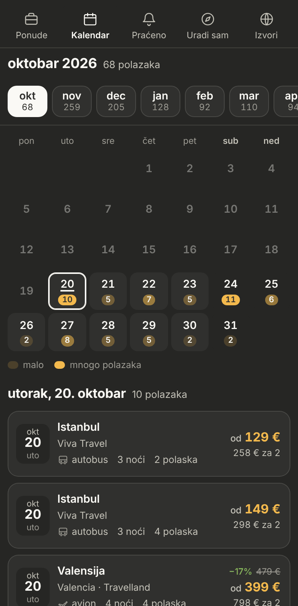
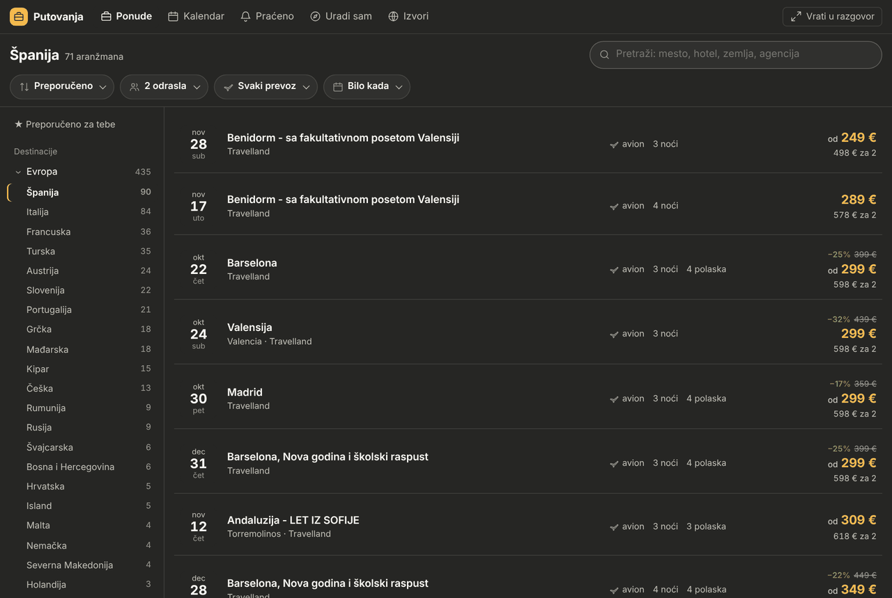
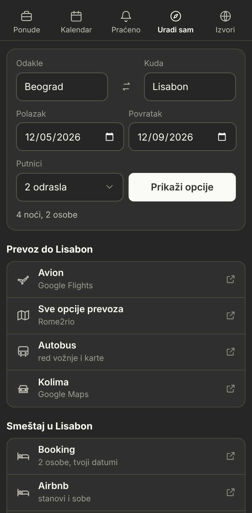
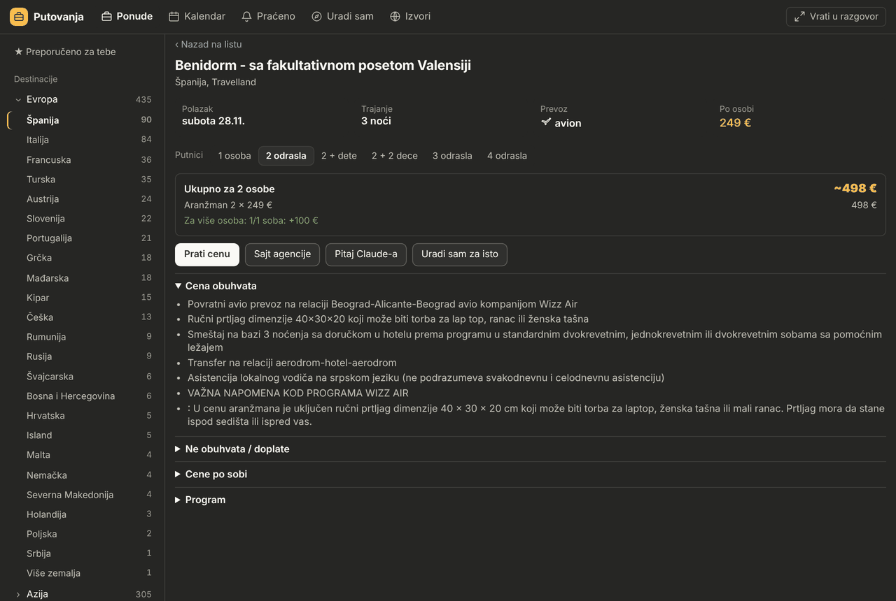
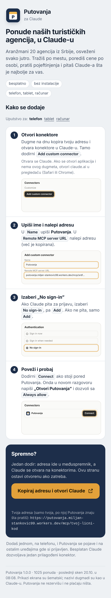
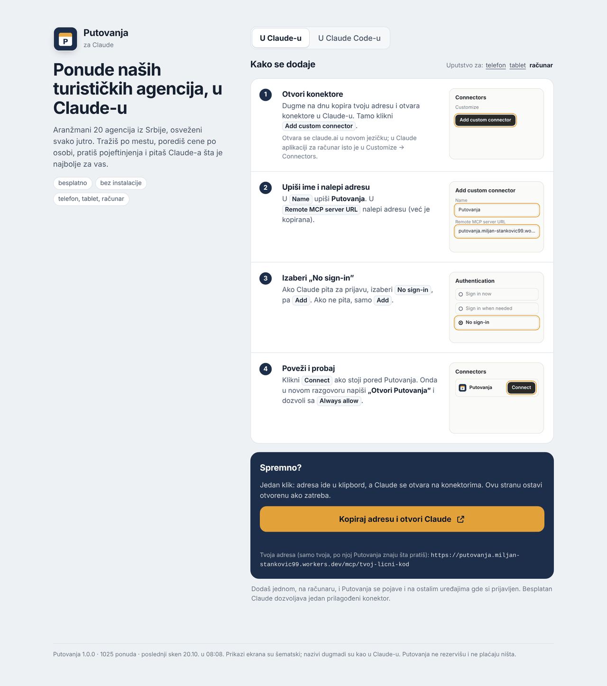
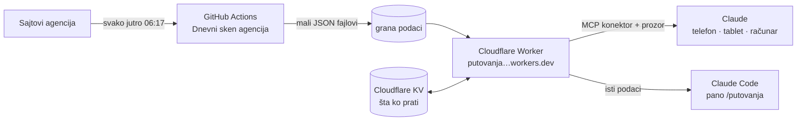

# Putovanja

**Ponude domaćih turističkih agencija, u Claude-u.** Aranžmani 23 agencije iz Srbije na jednom mestu, osveženi
svako jutro: tražiš po zemlji ili mestu, porediš cene po osobi i ukupno za svoje putnike, pratiš pojeftinjenja
i pitaš Claude-a šta je najbolje. Radi na telefonu, tabletu i računaru (kao prozor u razgovoru sa Claude-om) i u
Claude Code-u (kao pano pored razgovora). Besplatno, bez instalacije na telefonu.

<p align="center">
  
  
  
</p>

<p align="center">
  
</p>

> Putovanja ne rezervišu i ne plaćaju ništa. Za rezervaciju te šalju na sajt agencije.

---

## Sadržaj

- [Šta sve radi](#šta-sve-radi)
- [Instalacija](#instalacija)
- [Kako radi](#kako-radi)
- [Claude i prozor zajedno](#claude-i-prozor-zajedno)
- [Agencije](#agencije)
- [Claude Code: pano i komande](#claude-code-pano-i-komande)
- [Lokalni alat `pt` (napredno)](#lokalni-alat-pt-napredno)
- [Pregled agencija (izveštaj)](#pregled-agencija-izveštaj)
- [Struktura repozitorijuma](#struktura-repozitorijuma)
- [Razvoj](#razvoj)

## Šta sve radi

| Odeljak | Šta dobiješ |
|---|---|
| **Ponude** | Sve ponude po kontinentima i zemljama, pretraga (mesto, hotel, agencija), filteri: prevoz, mesec, broj putnika, redosled (preporučeno, najjeftinije, najveći popust, najskorije). Lista se puni dok skroluješ. |
| **Ponuda** | Svi polasci, trajanje, prevoz, cena po osobi i **ukupno za tvoje putnike** (odrasli i deca, sa doplatama), šta cena obuhvata i ne obuhvata, program sa sajta agencije, popusti za više osoba. Dugmad: Prati cenu, Sajt agencije, Pitaj Claude-a, Uradi sam za isto. |
| **Kalendar** | Polasci po danima, po mesecima, sa praznicima. Klik na dan pokazuje sve polaske tog dana. |
| **Praćeno** | Praćene cene i obaveštenja: pojeftinilo, nestalo, novo po tvojim željama. |
| **Uradi sam** | Odakle, kuda i datumi: linkovi za avion, autobus, auto, Booking, Airbnb, i Claude koji nađe 2–3 kombinacije prevoz + smeštaj i uporedi ih sa agencijama. |
| **Izvori** | Koje agencije su u katalogu, koliko ponuda ima svaka i kada je bio poslednji sken. |

<p align="center">
  
  
</p>

## Instalacija

Sve počinje sa jedne strane, koju možeš da pošalješ porodici i prijateljima:

### **[putovanja.miljan-stankovic99.workers.dev](https://putovanja.miljan-stankovic99.workers.dev)**

Strana sama napravi **ličnu adresu** (po njoj Putovanja znaju šta ko prati), jednim dugmetom je kopira i otvori
konektore u Claude-u. Uputstvo se prilagodi uređaju (telefon, tablet, računar).

<p align="center">
  
  
</p>

### 1. Konektor: telefon, tablet, računar, Chromebook

1. Na strani klikni **Kopiraj adresu i otvori Claude**.
2. U Claude-u: **Add custom connector**, ime *Putovanja*, u *Remote MCP server URL* nalepi adresu.
3. Ako pita za prijavu, izaberi **No sign-in**, pa **Add**.
4. **Connect**, pa u novom razgovoru napiši **„Otvori Putovanja”** i dozvoli sa **Always allow**.

Konektor dodaš jednom i Putovanja se pojave na svim uređajima gde si prijavljen u Claude. Besplatan Claude
dozvoljava jedan prilagođeni konektor. Izmene aplikacije stižu same, bez ponovnog dodavanja.

### 2. Pano u Claude Code-u (opciono, na računaru)

U Claude Code pošalji jednu pa drugu:

```
/plugin marketplace add MiljanStankovic/Trip-planner
/plugin install putovanja@putovanja
```

Zatvori i ponovo otvori Claude Code, pa otkucaj **`/putovanja`**. Ponude stižu sa istog servera kao konektor, pa
ništa drugo ne treba (ni Python). Da pano prati isto što i telefon:

```
/putovanja adresa <tvoja adresa konektora>
```

Adresa je u Claude-u: Podešavanja → Konektori → Putovanja. Ažuriranje plugina: `/plugin` → Update.

### 3. Dodatak za Claude desktop, lokalno (napredno)

[Putovanja.mcpb](https://github.com/MiljanStankovic/Trip-planner/raw/main/mcp/Putovanja.mcpb): isti prozor, ali
podaci i sken na tvom računaru umesto na serveru. Za većinu je konektor jednostavniji. Vidi [mcp/README.md](mcp/README.md).

## Kako radi



- **GitHub Actions** pripremaju podatke i objavljuju nove verzije:
  - **Dnevni sken agencija** ([sken.yml](.github/workflows/sken.yml)) svako jutro prođe kroz sajtove agencija,
    sačuva istoriju cena i objavi katalog na granu [`podaci`](https://github.com/MiljanStankovic/Trip-planner/tree/podaci)
    kao male JSON fajlove (po zemlji, po mesecu, po ponudi, indeks za pretragu).
  - **Objava servera na Cloudflare** ([server.yml](.github/workflows/server.yml)) postavi novu verziju servera i
    prozora kad se promeni kod u `main`.
- **Cloudflare Worker** ([server/worker](server/worker/src/index.js)) je konektor: MCP server sa prozorom (MCP App),
  početna strana za instalaciju i KV baza sa ličnim stvarima (praćeno, šta je otvoreno u prozoru, naredbe od Claude-a).
  Ne skenira ništa, samo čita gotove fajlove, pa staje u besplatni plan.
- **Grand Tours** odbija adrese GitHub-a, pa ga sken čita preko Workera (samo njegovu početnu stranu, jednom dnevno).

Skripte poštuju `robots.txt` svakog sajta i prave pauzu između stranica. Lična adresa konektora je privremena
zamena za prijavu (Google prijava je planirana); ne deli je, jer ko je ima vidi i menja tvoje praćenje.

## Claude i prozor zajedno

Dok je prozor otvoren, Claude vidi šta gledaš i može da ga menja. Primeri:

- „Nađi sve dnevne izlete”, „sve u oktobru do 300 €”, „Grčka avionom”: Claude pretraži sve ponude i rezultat se
  pojavi **u prozoru** kao lista sa naslovom.
- „Daj mi više o ovoj ponudi”: Claude zna koju ponudu gledaš.
- „Pokaži Španiju” ili „otvori kalendar za decembar”: prozor se prebaci sam.

Alati konektora: `otvori_putovanja`, `pretrazi_ponude`, `sta_vidim`, `pokazi_u_putovanjima`, `detalji_ponude`,
`skeniraj_agencije` (stanje skena) i `putovanja_podaci` (interno, za prozor).

## Agencije

| Agencija | Sajt | Šta se dobija |
|---|---|---|
| Travelland | travelland.rs | city break avionom, Egipat, Kipar; cene i stare cene |
| Argus Tours | argus.rs | sigurni polasci, praznici; cene „od” |
| Grand Tours | grandtours.rs | autobuski izleti i vikend putovanja, adventi; € ili dinari (čita se preko Workera) |
| Halo Tours | halotours.rs | adventi i vikend ture autobusom; € ili dinari |
| Belvi Travel | belvi.rs | autobusom i avionom, praznici |
| Felix Travel | felixtravel.rs | evropski gradovi i adventi |
| Fibula Air Travel | fibula.rs | hoteli sa letom iz Beograda |
| Jungle Tribe | jungletribe.rs | daleka i neobična putovanja (njihov javni JSON) |
| Kontiki | kontiki.rs | ture i Nova godina |
| Big Blue | bigblue.rs | evropske metropole |
| Odeon World Travel | odeontravel.rs | ture, wellness |
| Viva Travel | vivatravel.rs | ture, gradovi, praznici; svi polasci |
| Rapsody Travel | rapsodytravel.rs | gradovi, adventi, Nova godina |
| Go2 Travelling | go2travelling.net | gradovi, praznici, skijanje |
| I Travel | itravel.rs | daleke destinacije |
| Jumbo Travel | jumbo.rs | tropski paketi let + hotel |
| Lider Travel | lidertravel.rs | kalendar polazaka (~170), izleti bez noćenja |
| Oktopod Travel | oktopod.rs | evropski gradovi, praznici, izleti |
| Balkan Fun | balkanfun.travel | Nova godina, jesen, party putovanja |
| Plan A Travel | planatravel.rs | gradovi po zemljama; cene često na upit |
| Top Travel (Novi Sad) | toptravel.rs | jednodnevni izleti u dinarima, ture |
| Clock Travel (Niš) | clocktravel.rs | evropski gradovi iz Niša |
| Ponte Travel | ponte.rs | ture sa cenovnikom (malo aktuelnih ponuda) |
| Filip Travel | filiptravel.rs | **čita Claude** komandom `/putovanja:agencije`: sajt odbija skripte (Cloudflare provera) |

Nisu uključeni: **Atlantic Travel** (ture su stranice Filip Travela, hotelski smeštaj), **Dalix** (hoteli, ponude
se učitavaju JavaScript-om), **Play Travel** (istekao HTTPS sertifikat). Hotelsko letovanje po noćenju se ne
uvozi kao aranžman.

Nova agencija: mala klasa sa `pages` i `parse()` u [`src/putovanja/scrapers/`](src/putovanja/scrapers), dodata u
`scrapers/__init__.py`, plus test u [`tests/test_parsers.py`](tests/test_parsers.py). Agencije na istoj platformi
kao Travelland (adrese `/putovanja/<mesto>/<naziv>/<id>/`) dodaju se jednom klasom od tri reda u `lemax.py`.

## Claude Code: pano i komande

U Claude Code-u **`/putovanja`** otvara pano pored razgovora: levo kontinenti i zemlje, u sredini tabla polazaka,
desno izvori i konektori. Ceo red je klikabilan i otvara ponudu. `/putovanja Tajland` otvara pano odmah na Tajlandu.

```
┌ Putovanja  [Agencije]  Uradi sam  Praćeno ────────────────── Destinacije  Kalendar  Izvori ┐
│▌★ Preporučeno  │ Španija  71 aranžman                  👥 2 odrasla ▾   ↕ Najjeftinije ▾ │
│ Destinacije    │ Polazak    Destinacija               Prevoz      Trajanje      Po osobi │
│▾ Evropa    435 │ 22.10.     Barselona  −25%           ✈ avion     3 noći        od 299 € │
│ ▌Španija    90 │ četvrtak   4 polaska, Travelland     1/1 soba: +130 €         598 € za 2 │
│  Italija    84 │ 30.10.     Madrid  −17%              ✈ avion     3 noći        od 299 € │
│  …             │ petak      4 polaska, Travelland     1/1 soba: +140 €         598 € za 2 │
│ ✓ 23 agencije · sken danas · konektori 2/4                                               │
└──────────────────────────────────────────────────────────────────────────────────────────┘
```

Klik mišem radi kad je Claude Code preko celog prozora; inače `ctrl+x tab` prelazi u pano, `Tab` i strelice biraju,
`Enter` otvara. Claude u Claude Code-u takođe vidi pano i menja ga (alati `pano_stanje` i `pano_prikazi`).

| Komanda | Šta radi |
|---|---|
| `/putovanja [zemlja]` | Pano Putovanja pored razgovora |
| `/putovanja adresa <adresa>` | Poveži pano sa svojim konektorom (isto praćeno kao na telefonu) |
| `/putovanja:pano [zemlja]` | Isto što i `/putovanja`, za Claude aplikaciju (tamo je u meniju od starta) |
| `/putovanja:zemlja Tajland` | Sve ponude za zemlju ili grad, najbolji termini i detalji sa sajtova |
| `/putovanja:istrazi <tema>` | Istraživanje: letovi, smeštaj, aranžmani, vize, poređenje sa „uradi sam” |
| `/putovanja:uradi-sam <kuda> <od> <do>` | Prevoz + smeštaj u sopstvenoj režiji, ukupna cena, poređenje sa agencijama |
| `/putovanja:agencije` | Sveže skeniranje na računaru, plus Filip Travel preko Claude-a |
| `/putovanja:pregled [auto]` | Izveštaj: nove i pojeftinjene ponude sa preporukama ([više](#pregled-agencija-izveštaj)) |
| `/putovanja:profil` | Profil: putnici (odrasli, deca), budžet, šta voliš, aerodrom |
| `/putovanja-trello:predlozi`, `/putovanja-trello:planiraj` | Samo uz Trello dodatak |

### Konektori za letove i smeštaj

Pano pokazuje koje konektore imaš (Expedia, SlickTrip, eDreams, Civitatis). Dodaju se jednom na claude.ai
(Customize → Connectors) i Claude Code ih posle sam vidi. Bez njih sve radi, samo Claude za letove i smeštaj
koristi pretragu i linkove.

### Trello (opciono, podrazumevano isključen)

Dodatak **putovanja-trello** donosi Trello tablu za ideje i planirana putovanja:
`claude plugin install putovanja-trello@putovanja` (ili `/plugin`). Isključivanje: `/plugin disable putovanja-trello`.
Tablu povezuješ preko Trello konektora na claude.ai.

## Lokalni alat `pt` (napredno)

Mali Python alat **`putovanja`** (skraćeno **`pt`**) skenira agencije na tvom računaru, čuva istoriju cena i radi u
terminalu. Ne treba za konektor ni za pano; pano ga koristi samo kad u podešavanjima plugina upišeš putanju (`ptPath`).

**Windows (PowerShell):**

```powershell
irm https://raw.githubusercontent.com/MiljanStankovic/Trip-planner/main/install.ps1 | iex
```

**macOS / Linux:**

```bash
curl -fsSL https://raw.githubusercontent.com/MiljanStankovic/Trip-planner/main/install.sh | bash
```

Instalacija donese i [uv](https://docs.astral.sh/uv/) (on donese Python). Opcije pre komande:
`PUTOVANJA_BEZ_SKENA=1` preskače prvi sken, `PUTOVANJA_TRELLO=1` uključuje Trello dodatak,
`PUTOVANJA_GRANA=ime` instalira probnu granu.

```
pt top [preporuka|popust|jeftino|specijal|uskoro|izlet]
pt zemlje                         broj ponuda po kontinentu i zemlji
pt zemlja tajland                 sve ponude za zemlju ili grad
pt ponuda <ID> [--detalji]        sve o ponudi; --detalji čita program i cene sa sajta
pt kalendar [YYYY-MM]             polasci po danima
pt agencije skeniraj [--samo travelland lider]
pt agencije nove [--dana 7]       prvi put viđene ponude
pt agencije ubaci ponude.json     ponude koje je Claude pročitao (Filip Travel)
pt agencije istorija <ID>         kako se kretala cena
pt agencije odbij <ID>            ne predlaži više
pt preporuke [--limit 10]         najbolje po profilu
pt prati [<ID>]                   praćenje cene
pt obavestenja                    pad cene praćenih, nove po željama
pt popusti <ID> [<ID> ...]        popusti za više osoba
pt uradisam lista|sacuvaj|obrisi  sačuvane kombinacije prevoz + smeštaj
pt izvori | pt stanje             agencije, greške, poslednji sken
pt trello tabla | predlog <ID> | dodaj --lista izleti --naslov "Segedin"
pt profil | pt init
```

Svaka komanda prima `--json` (tako ih zovu Claude komande). Baza je u `~/.local/share/putovanja/putovanja.db`
(menja se sa `PT_DATA`), profil u `~/.config/putovanja/config.toml` (`PT_CONFIG`).

`pt trello` koristi Trello REST API sa ključem iz okruženja (`TRELLO_KEY`, `TRELLO_TOKEN`), nikad iz fajla ili gita.
Bez ključa sve ostalo radi; Claude komande koriste Trello konektor.

## Pregled agencija (izveštaj)

Ovo **nije** dnevni sken (on ide sam, na serveru). Pregled je izveštaj koji piše Claude: nove i pojeftinjene
ponude, preporuka, promene cena, uz Trello dodatak i predlozi na tabli. Pokreće se ručno sa `/putovanja:pregled`,
ili zakazano na tvom računaru:

macOS / Linux (`crontab -e`), npr. nedeljom u 09:47:

```
47 9 * * 0  /putanja/do/Trip-planner/scripts/pregled-agencija.sh
```

Na dve nedelje: `PT_SVAKE_DVE=1` ispred skripte. Windows: komentar na vrhu
[`scripts/pregled-agencija.ps1`](scripts/pregled-agencija.ps1) (schtasks). Prvi put pokreni `/putovanja:pregled`
ručno i dozvoli alate („Always allow”). Izveštaji idu u `izvestaji/YYYY-MM-DD.md`, logovi u `logs/`.

## Struktura repozitorijuma

```
server/worker/        Cloudflare Worker: konektor (MCP + prozor), početna strana, KV
server/izvezi.py      baza → mali JSON fajlovi za granu podaci
mcp/ui/               izvor prozora (prozor.src.html); mcp/napravi.py ga gradi
mcp/                  dodatak za Claude desktop (.mcpb), lokalni MCP server
hooks/register.tsx    pano /putovanja za Claude Code
commands/, skills/    Claude Code komande i skillovi
plugins/putovanja-trello/   opcioni Trello dodatak
src/putovanja/        alat pt: skeneri agencija, baza, preporuke, detalji, popusti
scripts/              zakazani pregled agencija (izveštaj)
.github/workflows/    Dnevni sken agencija, Objava servera na Cloudflare
docs/slike/           slike za ovaj README
```

## Razvoj

```bash
pip install -e ".[dev]" && pytest      # skeneri (testovi sa malim HTML primerima)
claude plugin test .                   # pano za Claude Code
python mcp/napravi.py                  # prozor: mcp/ui/prozor.src.html → mcp/src/prozor.html
python mcp/napravi.py --paket          # i dodatak mcp/Putovanja.mcpb
```

Push u `main` sam objavi server (ako su menjani `server/worker`, `mcp/ui` ili `mcp/napravi.py`). Sken se pokreće
svako jutro, ili ručno: GitHub → Actions → Dnevni sken agencija → Run workflow. Provera objave:
`curl https://putovanja.miljan-stankovic99.workers.dev/stanje` pokazuje verziju i broj ponuda.

Verzija je ista na svim mestima: `.claude-plugin/plugin.json`, `pyproject.toml`, `src/putovanja/__init__.py`,
`mcp/manifest.json`, `mcp/pyproject.toml`, `mcp/src/server.py`, `mcp/ui/prozor.src.html` i `VERZIJA` u
`server/worker/src/index.js`.

Secreti (Cloudflare token i nalog) su samo u GitHub secrets repozitorijuma, nikad u kodu.

---

Delovi rada sa Claude-om (faze planiranja, provera pre polaska, „tri opcije sa stavom”) inspirisani su skillovima
[apljacob/travel-agent](https://github.com/apljacob/travel-agent),
[Filip-Kin/travel-agent-skill](https://github.com/Filip-Kin/travel-agent-skill) i
[d-wwei/trip-planner](https://github.com/d-wwei/trip-planner); kod nije kopiran.
